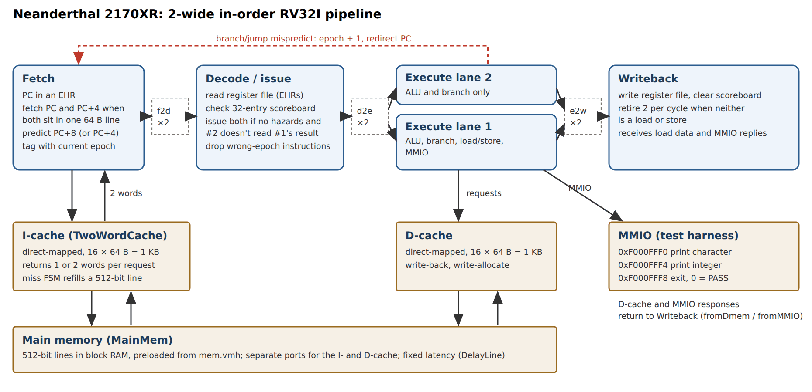
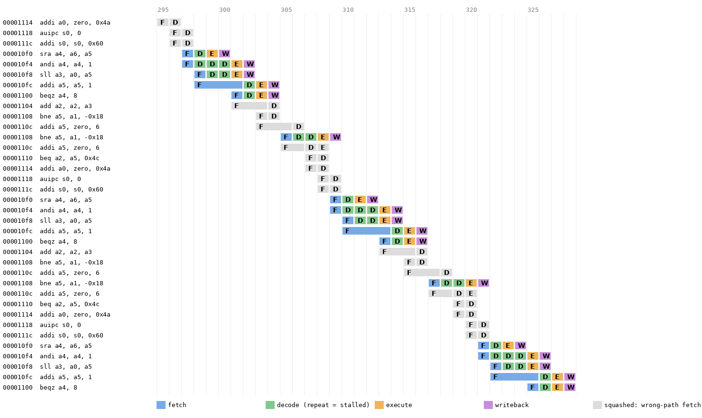

# Neanderthal 2170XR: two-wide superscalar RISC-V core

A **two-wide, in-order superscalar RV32I processor with instruction and data caches**, written in **Bluespec SystemVerilog**. It passes all 11 test programs in cycle-accurate simulation (with the memory-model note under [Known issues](#known-issues)). A port to the **OrangeCrab** (Lattice ECP5) FPGA board is in progress. It was built in spring 2023 for MIT's Constructive Computer Architecture course (6.1920).

**Team:** Ahmad Taka and Neel Mondal. Development history lives in the original repo, [`nmondal417/Neanderthal2170XR`](https://github.com/nmondal417/Neanderthal2170XR); this repo is a reorganized copy made with Neel's permission. MIT license; see [LICENSE](LICENSE).



## Results

Measured in October 2026 by building the final code with `bsc` 2025.07 and running the test programs in Bluesim. Reproduce with `tools/run_tests.sh` (see [Reproducing](#reproducing)). "Dual writeback" is the share of writeback cycles that retired two instructions at once.

| Program | Result | Cycles | Instructions | IPC | Dual writeback | Single-issue pipeline cycles¹ |
|---|---|---:|---:|---:|---:|---:|
| `add`, `and`, `or`, `sub`, `xor` | PASS | 105 | 46 | 0.44 | 70 % | 369 |
| `hello` | PASS | 570 | 311 | 0.55 | 19 % | 939 |
| `mul` (software multiply) | PASS | 552 | 281 | 0.51 | 48 % | 874 |
| `reverse` | PASS | 16,356 | 9,575 | 0.59 | 16 % | 16,401 |
| `thuemorse` | PASS | 19,520 | 11,866 | 0.61 | 30 % | 19,811 |
| `thelie` | PASS² | 46,231 | 25,871 | 0.56 | 13 % | 44,551 |
| `matmul` | PASS² | 1,617,410 | 835,066 | 0.52 | 52 % | 1,479,789 |

¹ `fpga/processor_cache`: the earlier 4-stage single-issue pipeline, which uses **8 KB** caches against the superscalar's **1 KB**.
² With the dual-port simulation memory; see [Known issues](#known-issues).

**What the numbers say.** Dual issue does happen often (up to 70 % of retire cycles), but sustained IPC stays around 0.5–0.6. Three things hold it back:
- every taken branch costs a flush, because the next PC is always predicted as sequential;
- the scoreboard stalls dependent pairs;
- the caches were cut to 1 KB to fit the FPGA.

The superscalar is 1.6–3.5× faster than the single-issue pipeline on the short programs. It roughly ties on `reverse` and `thuemorse`, and is about 9 % slower on `matmul` and 4 % slower on `thelie`, where the 8× smaller caches dominate. A branch predictor and restoring the larger caches are the obvious next steps.

### Pipeline trace



<sub>Konata log from the `mul` test's inner loop, drawn with `tools/konata_plot.py`. Pairs fetched together (`sra`/`andi`) go through decode together. The `andi`→`sll` dependency shows up as repeated `D` (scoreboard stall). Grey rows are instructions fetched down the wrong path and squashed after the `bne`/`beqz` resolves.</sub>

## Status

| Area | Status |
|---|---|
| Cache (lab) | ✅ Passes the randomized cache test |
| Pipelined core + caches | ✅ Passes all test programs |
| Superscalar core + caches | ✅ All 11 programs pass with the dual-port simulation memory; see Known issues for the final commit's memory setting |
| Superscalar with 16-byte lines | 🟡 Some tests pass |
| OrangeCrab FPGA port | 🟡 Compiles to Verilog with a 1 KB block-RAM main memory; LiteDRAM not integrated; no bitstream committed |

## How the design evolved

Each folder under `fpga/` is a self-contained snapshot with its own `Makefile`, test programs and `elf2hex`.

| Folder | What it adds |
|---|---|
| [`fpga/cache_lab`](fpga/cache_lab) | Direct-mapped, write-back, write-allocate cache: 128 lines × 64 B (8 KB). Data in block RAM; tags, valid and dirty bits in registers. A store buffer is written but disabled. Tested in isolation against an ideal memory with random requests (`./Beveren`). |
| [`fpga/processor_cache`](fpga/processor_cache) | Multicycle and 4-stage pipelined RV32I cores connected to the 8 KB caches |
| [`fpga/processor_cache_test`](fpga/processor_cache_test) | A working copy of `processor_cache` that adds `Supfifo.bsv`, the two-entry FIFO the superscalar is built on |
| [`fpga/superscalar_cache`](fpga/superscalar_cache) | **The main design**: two-wide superscalar core, 1 KB instruction cache returning two words, 1 KB data cache |
| [`fpga/superscalar_cache_small`](fpga/superscalar_cache_small) | Same core with 4-word (16 B) cache lines and a 128-bit memory interface for the FPGA (`arrange_mem.py` repacks memory images). Work in progress. |
| [`fpga/superscalar_orangecrab`](fpga/superscalar_orangecrab) | OrangeCrab r0.2 top level (`OrangeCrabTop.bsv`) with a USB-serial console and an RGB LED. Main memory is a preloaded 16 × 512-bit block RAM. |

## Microarchitecture (`fpga/superscalar_cache`)

- **Fetch** sends one request per cycle for the PC. If PC+4 is in the same 64-byte line, the instruction cache returns both words and two instructions are fetched (PC += 8); otherwise one is fetched. The next PC is always predicted as sequential.
- **Decode** reads the register file and checks a 32-entry **scoreboard**. Both instructions issue when neither has a pending source or destination and the second doesn't read the first's result. Otherwise only the first issues. Instructions from the wrong path are dropped by comparing their **epoch** tag with the current one.
- **Execute** has two lanes, written as two Bluespec rules so both can fire in one cycle. Lane 2 handles only ALU and branch instructions; loads and stores go through lane 1. A mispredicted branch or jump bumps the epoch and redirects the PC.
- **Writeback** retires two instructions per cycle when neither is a memory operation. It clears scoreboard bits and writes the register file.
- The PC, register file, scoreboard and epoch are **EHRs** (ephemeral history registers), so rules firing in the same cycle see each other's updates in a fixed order.
- **Caches:** direct-mapped, write-back, 16 lines × 64 B each, with block RAM for data and a small miss FSM (`Ready → StartMiss → SendFillReq → WaitFillResp`). The instruction cache returns a 65-bit "one or two words" response.
- **Memory-mapped I/O** (test harness): `0xF000FFF0` prints a character, `0xF000FFF4` prints an integer, `0xF000FFF8` ends the test (0 = PASS).
- **Instrumentation:** counters for how often execute and writeback handle two instructions, and **Konata** pipeline traces (`output.log`).

## Reproducing

### 1. Install the tools

- **Bluespec compiler `bsc`**, prebuilt from <https://github.com/B-Lang-org/bsc/releases>. Release 2025.07 for Ubuntu 24.04 was used for the results above.
  ```bash
  tar xzf bsc-2025.07-ubuntu-24.04.tar.gz && export PATH=$PWD/bsc-2025.07-ubuntu-24.04/bin:$PATH
  sudo apt install tcl8.6        # Bluesim's launcher needs libtcl8.6
  ```
- Only needed to rebuild the test programs: a RISC-V GCC (`riscv64-unknown-elf-gcc`). Prebuilt `.hex` files are already in each `test/build/`.
- Only needed for pipeline pictures: `pip install pillow capstone`.

### 2. Build and run one test

```bash
cd fpga/superscalar_cache
make                          # bsc -sim → ./top_pipelined
./test.sh add32               # copies test/build/add32.hex to mem.vmh
./top_pipelined               # prints PASS / FAIL
./test_all_pipelined.sh       # all 11 programs
```

The final commit leaves `debug = True` in `pipelined.bsv`, so the first 1,000 cycles print a per-stage log. Set it to `False` for quiet runs.

### 3. Reproduce the results table

```bash
tools/run_tests.sh                       # superscalar, dual-port memory: the table above
tools/run_tests.sh superscalar_cache as-is   # exactly as committed (thelie and matmul time out)
tools/run_tests.sh processor_cache       # single-issue baseline cycles
```

`run_tests.sh` works on a temporary copy. It turns off the debug log, prints the dual-issue counters and the cycle count at exit, and optionally switches to the dual-port memory. Nothing in `fpga/` is changed.

### 4. Pipeline trace

Set `konata_debug = True` in `pipelined.bsv`, rebuild, and run a test. Then either open `output.log` in the [Konata](https://github.com/shioyadan/Konata) viewer, or draw it:

```bash
python3 tools/konata_plot.py output.log trace.png 300 36    # instructions 300–335
```

### 5. Rebuild the test programs (optional)

```bash
cd fpga/superscalar_cache/test && make     # rv32i, -nostdlib, linked with mmio.ld, 512-bit-wide hex
```

### 6. The cache lab on its own

```bash
cd fpga/cache_lab && make && ./Beveren     # random requests vs. an ideal memory
```

## FPGA build (`fpga/superscalar_orangecrab`)

The target is the OrangeCrab r0.2 (ECP5-25F, CSFBGA285), built with the open-source toolchain: yosys, nextpnr-ecp5, ecppack and dfu-util, for example from the [OSS CAD Suite](https://github.com/YosysHQ/oss-cad-suite-build).

```bash
cd fpga/superscalar_orangecrab
# edit USBCORE in TestBuildUsb.sh to point at ./tinyfpga_bx_usbserial (it holds an absolute path from the original machine)
./TestBuildUsb.sh             # bsc -verilog OrangeCrabTop.bsv into build/, plus the USB core, BRAM/FIFO Verilog, pins, Makefile
cd build
make                          # yosys synth_ecp5 → nextpnr-ecp5 (usborange.pcf) → ecppack → color.dfu
make dfu                      # hold the OrangeCrab button while plugging in, then dfu-util uploads
```

The core's character and integer output goes to the host as a USB serial port, using the TinyFPGA BX USB-serial core in `tinyfpga_bx_usbserial/`. Main memory is one preloaded block RAM of 16 × 512-bit lines (1 KB), so only small programs fit. `Litedram.bsv`, `litedram.v` and `DramOnly.py` are the start of an unfinished LiteDRAM (DDR3) integration.

## Known issues

- **Final commit uses the FPGA memory model in simulation.** The last two commits switched `fpga/superscalar_cache/top_pipelined.bsv` from `mkMainMem2` (dual-port block RAM, one port per cache) to `mkMainMemFPGA`. That model shares a single-port BRAM between the I- and D-caches, and with it **`thelie` and `matmul` hang**; the other 9 programs still pass. Changing line 15 back to `MainMem2 dram <- mkMainMem2;` restores the earlier behaviour, and all 11 programs pass. Checking the history showed `thelie` passing at every commit up to `ee1c73e` (May 14) and hanging from `da7f8d6` (May 15) onward.
- The 16-byte-line variant (`superscalar_cache_small`) only passes some tests, per the final commit message.
- Bluespec build outputs (`build/`, `*.bo`, `*.so` and the generated simulator launchers such as `top_pipelined`) are git-ignored; `make` regenerates them. The prebuilt test programs in `test/build/*.hex` are kept.

See [docs/STRUCTURE.md](docs/STRUCTURE.md) for the folder conventions shared across my projects.
